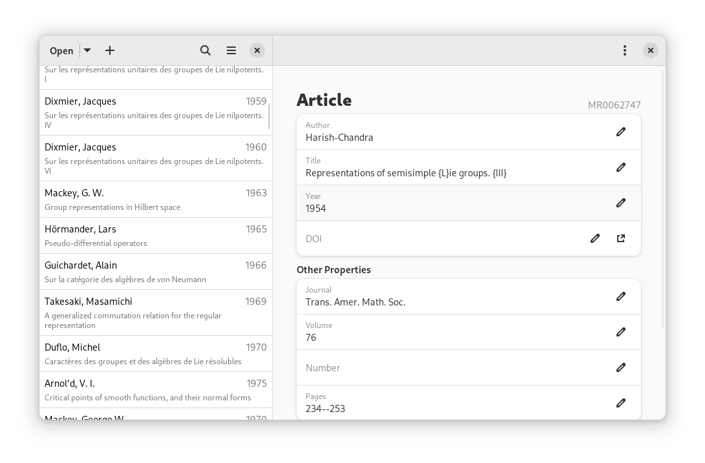

# Citations

Manage your bibliographies using the BibTeX format.

## Screenshots

## Warning

Citations does not support local variables nor comments, and that data might be lost. Please make a backup of your BibTeX file if you use them.

## Hack on Citations

To build the development version of Citations and hack on the code see the
[general guide](https://welcome.gnome.org/app/Citations/#getting-the-app-to-build) for
building GNOME apps with Flatpak and GNOME Builder.

## Translations

Helping to translate Citations or add support to a new language is very welcome.
You can find everything you need at: [l10n.gnome.org/module/citations/](https://l10n.gnome.org/module/citations/)

## Code Of Conduct

This project follows the [GNOME Code of Conduct](https://conduct.gnome.org/).
